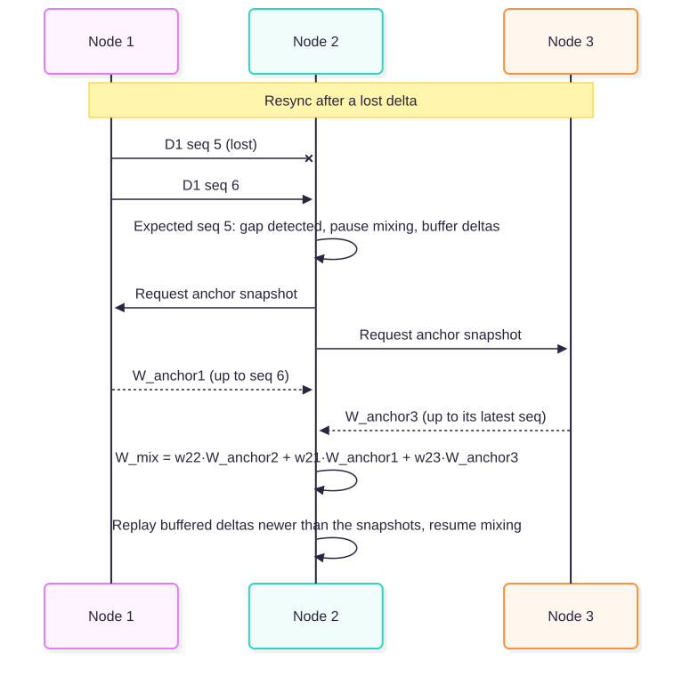
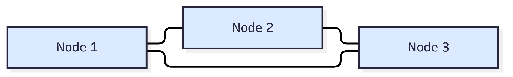
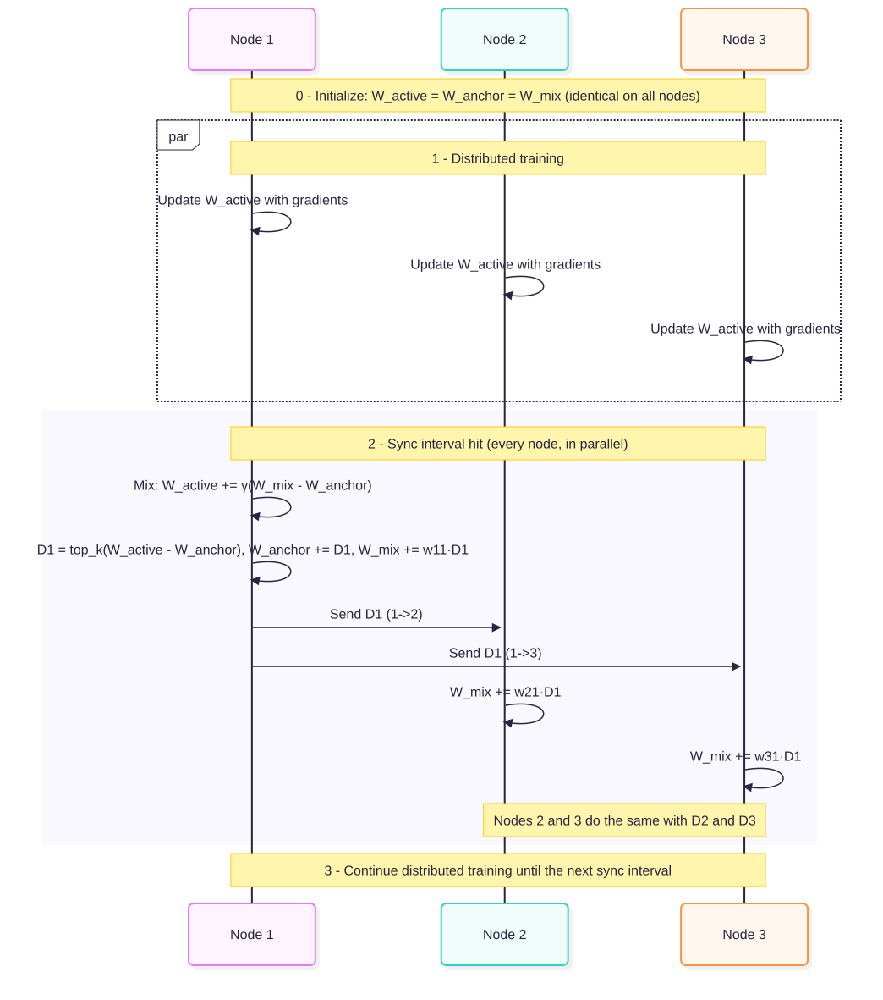

# DeltaFabric

A decentralized weight synchronization protocol for distributed ML training with built-in networking. Currently supporting PyTorch and Burn.

DeltaFabric's synchronization is based on CHOCO-SGD by Koloskova, Stich and Jaggi ([ICML 2019](https://arxiv.org/abs/1902.00340)). See [Citation](#citation).

## Core Concepts

### No-Master Architecture

Eliminates master-server bottlenecks by letting every node participate equally in synchronization. It also makes life easier by cutting out the need to set up or manage a central server.

### Built-in Networking and Automatic Peer Discovery

We include a built-in networking layer powered by the `Zenoh` P2P protocol. Nodes discover peers and exchange deltas automatically without external coordination.

### Anchor-Active Weight Model

We maintain three weight buffers per node:

- **W_active**: weights currently being optimized by local gradients
- **W_anchor**: the copy of this node's weights that its neighbors know about
- **W_mix**: the weighted sum of this node's anchor and its neighbors' anchors

The delta between W_active and W_anchor captures the local updates not yet sent. Since all nodes start from identical weights, every neighbor's anchor can be rebuilt from the deltas it sends, so W_mix is maintained from received deltas alone. No node ever stores or sends a copy of a peer's model, regardless of how many neighbors it has.

### Consensus Mixing

At every sync interval, each node moves its weights a step `gamma` toward the average of its neighbors:

`W_active += gamma * (W_mix - W_anchor)`

This pull is proportional to how far apart the nodes are, which keeps the models together while each trains on its own data. Neighbor weights are Metropolis weights, so mixing preserves the cluster average. This is the CHOCO-SGD algorithm (Koloskova, Stich & Jaggi, ICML 2019).

### Compressed Delta

Sending an entire set of weights becomes impractically large as the model grows. To reduce bandwidth and increase speed, we only send the most significant changes (the top-k of `W_active - W_anchor`) per sync. What is not sent stays in the difference and goes out later, so no local progress is lost. Each packet carries only the sender's own delta.

Each entry is packed tightly: indices are sent as LEB128-encoded gaps between sorted positions (about 1 byte each at 1% density instead of 4), and values can be sent as `f32` (4 bytes), `int8` (1 byte, scaled by the largest value) or `sign` (1 bit, scaled by the mean absolute value). Lossy encodings are safe because the anchor records the decoded values that were actually sent: the rounding error stays in `W_active - W_anchor` and is sent later.

Heavier compression needs a smaller `gamma`: keep `gamma <= 2 * delta_selection_ratio`, or the nodes can diverge.

### Reliable Delivery

All nodes must start from identical weights (use the same seed) and call `fabric.step(model)` once before training, so each node records those weights as its starting anchor. W_mix is only correct if every delta arrives exactly once. Deltas carry consecutive sequence numbers; a gap (or a node that started from different weights) triggers a resync, where the node requests its neighbors' full anchors once and rebuilds W_mix.

<div align="center">
  
</div>

## Quick Start

### PyTorch

```bash
pip install delta_fabric
```

```python
from delta_fabric import Config, Fabric

fabric = Fabric(node_id=1, config=Config(peers=[2, 3]))

torch.manual_seed(42)  # identical initial weights on every node
model = fabric.step(model)  # register the initial weights before training

for images, targets in loader:
    optimizer.zero_grad()
    criterion(model(images), targets).backward()
    optimizer.step()
    model = fabric.step(model)
```

### Burn

```toml
[dependencies]
delta_fabric = { git = "https://github.com/JiraPit/DeltaFabric", features = ["burn"] }
```

```rust
use delta_fabric::{Config, Fabric};

let mut fabric = Fabric::new(1, Config::new(vec![2, 3])).await?;
model = fabric.step(model).await?; // register the initial weights before training

for batch in dataset {
    let grads = GradientsParams::from_grads(model.forward_classification(batch).loss.backward(), &model);
    model = optimizer.step(lr, model, grads);
    model = fabric.step(model).await?;
}
```

Run one process per node, each with its own `node_id` and the IDs of the nodes it links to. See [examples/](examples/) for complete MNIST and Stanford Cars scripts.

## Example Setup

The ring topology below represents a minimal DeltaFabric cluster of three nodes, where each node is linked to the other two:

<div align="center">
  
</div>

This sequence diagram illustrates the weight delta synchronization process for the ring topology. Links are undirected, so each node exchanges deltas with the two nodes next to it. All nodes start with identical weight buffers and train locally in parallel. When a node hits its sync interval, it mixes toward its neighbors, then computes a compressed delta and sends it to its neighbors, which add it to their W_mix.

<div align="center">
  
</div>

## Citation

DeltaFabric implements CHOCO-SGD. Many thanks to its authors:

```bibtex
@inproceedings{koloskova2019decentralized,
  title     = {Decentralized Stochastic Optimization and Gossip Algorithms with Compressed Communication},
  author    = {Koloskova, Anastasia and Stich, Sebastian U. and Jaggi, Martin},
  booktitle = {Proceedings of the 36th International Conference on Machine Learning},
  series    = {Proceedings of Machine Learning Research},
  volume    = {97},
  pages     = {3478--3487},
  year      = {2019}
}
```
